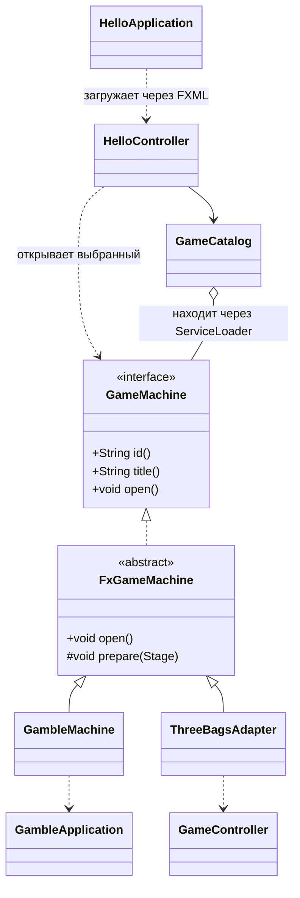
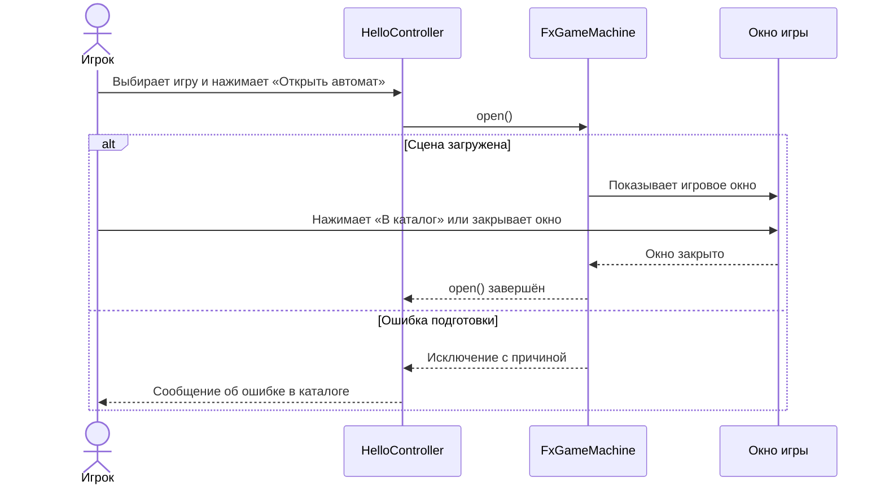

# Архитектура интеграции 1

## Диаграмма классов

На диаграмме показаны два адаптера. Остальные подключаются через тот же интерфейс.

## Открытие и возврат

## Проверка по методичке

| Проверки | Реализация |
| --- | --- |
| **T1.1** · каталог | `GameCatalogTest` проверяет идентификаторы всех семи автоматов. |
| **T1.2** · выбор и запуск | `HallWindowTest` выбирает каждую игру в настоящем окне JavaFX, вносит монету и запускает игру. |
| **T1.3** · возврат | `HallWindowTest` проверяет кнопку возврата, системное закрытие окна и переход к другой игре после завершённого раунда. |
| **T1.4** · подключение | `GameCatalogTest` проверяет обнаружение независимого модуля `tests/probe`, который подключается на время тестов. |
| **T1.5** · отказ | Тестовый автомат выбрасывает исключение при подготовке окна. `HallWindowTest` проверяет сообщение и последующий запуск рабочей игры. |
| **AT1.1** · сборка и запуск | Инструкции запуска и проверка состава рабочего каталога приведены в [README](../README.md). |
