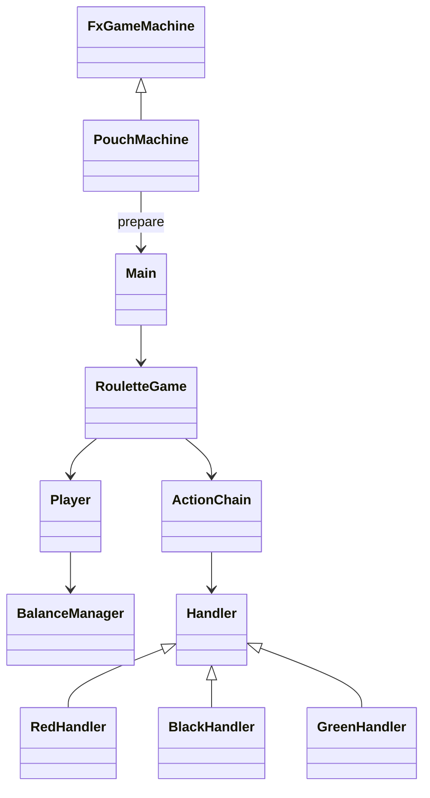

# Рулетка — Путилин

Модуль `games/putilin` адаптирован к ветке `hall-balance`. Изменения ограничены этим модулем.

## Подключение к залу

`PouchMachine` реализует контракт зала через `FxGameMachine`. Сохранён идентификатор `putilin.pouches`, который уже зарегистрирован в каталоге и проверяется общими тестами. Отображаемое название изменено на «Рулетка — Путилин». Регистрация через `provides GameMachine` и Maven-зависимость зала уже существуют.

`Main.prepare(Stage)` только создаёт сцену. Показ модального окна, кнопку «В каталог» и закрытие обеспечивает `FxGameMachine`. При закрытии окна рулетка останавливает анимацию. При повторном открытии создаётся новый экран с актуальным общим балансом.

## Правила и баланс

Колесо состоит из девяти равных секторов: четыре красных, четыре чёрных и один зелёный. Первые восемь чередуются. Каждый сектор выбирается с вероятностью 1/9 независимо от ставки и баланса.

| Ставка | Выплата при совпадении цвета |
| --- | --- |
| Красный | Сумма ставки ×2 |
| Чёрный | Сумма ставки ×2 |
| Зелёный | Сумма ставки ×5 |

Выплата включает исходную ставку. Например, при балансе 100 и ставке 10 на зелёный итоговый баланс равен 140 при выигрыше и 90 при проигрыше.

Допускается целая ставка от 1 до 10000 монет, не превышающая баланс. Сумму можно ввести с клавиатуры или выбрать кнопками 10, 25, 50, 100. Enter запускает раунд. Кнопка «+10 монет» пополняет общий счёт через `BalanceManager`.

`Player` не хранит собственные монеты и не выдаёт начальный баланс. Он обращается к общему `BalanceManager`. `RouletteGame.play` проверяет ставку, списывает её, выбирает сектор и начисляет выплату один раз. Во время анимации новые ставки заблокированы.

Расчёт раунда заканчивается до анимации. Если игрок закрыл окно во время вращения, ставка и выплата остаются учтёнными. Анимация только показывает уже полученный результат; её завершение, остановка и повторное открытие не меняют баланс.

## Классы



Цепочка передаёт результат обработчикам красного, чёрного и зелёного цвета. Подходящий обработчик возвращает выплату; при несовпадении со ставкой возвращается ноль. Вероятности не зависят от цепочки выплат.

## Проверка

Из корня репозитория:

```powershell
.\mvnw.cmd -B verify
.\mvnw.cmd -B -pl games/putilin -am test '-Dcasino.gui.tests=true'
```

`RouletteGameTest` проверяет все 27 сочетаний сектора и выбранного цвета, выплату ×5, общий баланс, диапазон ставок и повторное открытие без бесплатных монет. `RouletteWindowTest` проверяет ввод, готовые суммы, Enter, блокировку повторной ставки, модальное открытие через адаптер и возврат в каталог.

За пределами модуля остаются общие тексты и GUI-сценарии старых мешочков: описание карточки `putilin.pouches` в `hall/HelloController` и сценарии Путилина в `hall/HallWindowTest`. Они требуют отдельного обновления интегратором; стандартный `verify` не включает GUI-сценарии. Новые проверки рулетки расположены внутри `games/putilin`.

В текущем общем API нет контракта результата раунда или стратегий зала. Модуль использует существующий `BalanceManager` и не добавляет собственную общую систему или скрытые бонусы.
